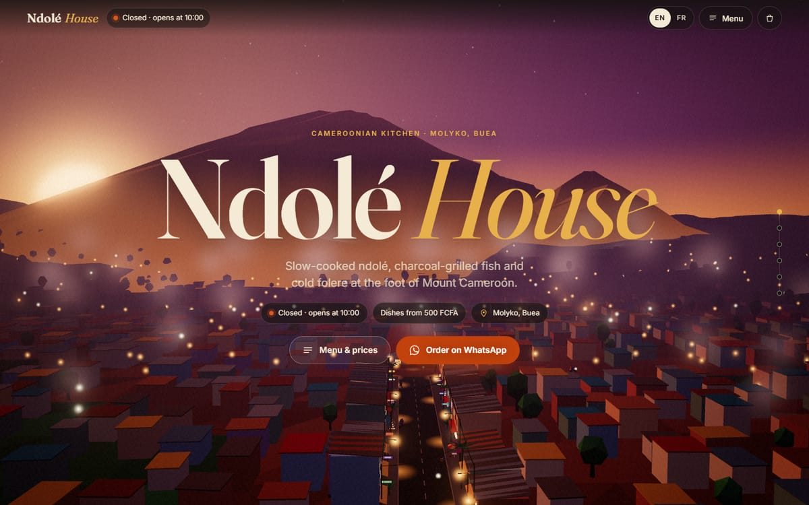
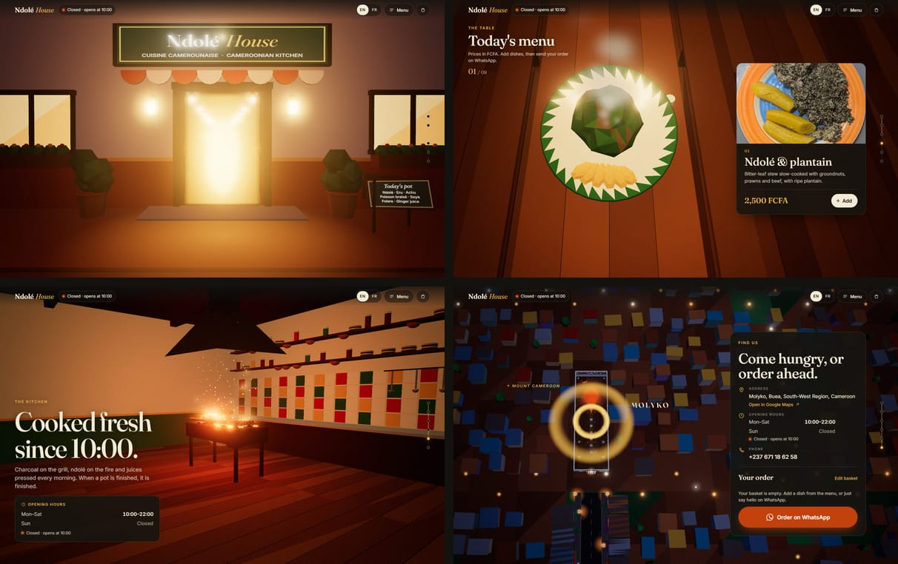
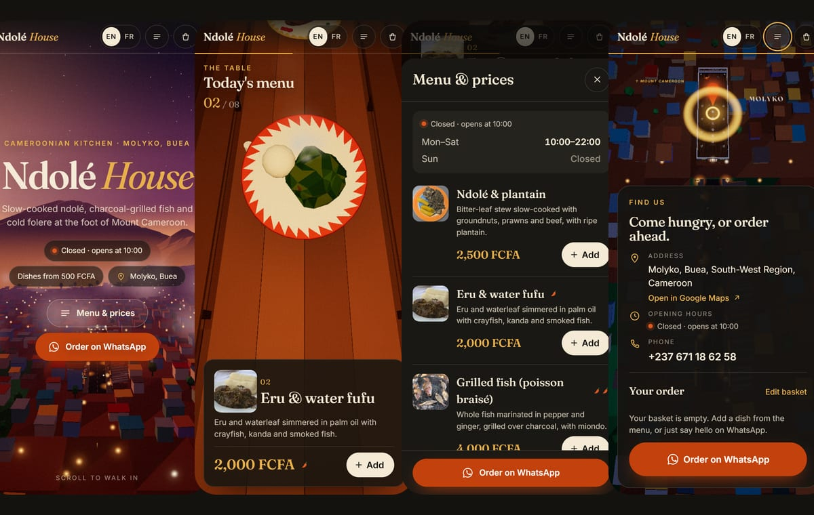

# Ndolé House · 3D restaurant website

**Live site: https://mrbankz61-hash.github.io/restaubuea/**

A concept website for Ndolé House, a Cameroonian kitchen in Molyko, Buea, designed and built by **TREDEV** (Tchinda Raoul Emmanuel · [bankyrex2@gmail.com](mailto:bankyrex2@gmail.com) · WhatsApp [+237 671 18 62 58](https://wa.me/237671186258)).



Scrolling is one continuous camera move: from dusk over Mount Cameroon, down a Molyko street, through the restaurant door, over the table where each dish rises to meet you, past the grill, and up through the roof to a map of the town and a big **Order on WhatsApp** button.



The page always answers the three lunch-rush questions straight away: the menu, the prices (FCFA) and the opening hours. They are real HTML text in English and French, readable before any 3D loads, and they still work without WebGL. The basket writes the order into a pre-filled WhatsApp message.



Stack: Vite, vanilla three.js, GSAP + ScrollTrigger, Lenis, plain CSS. No React. About 228 KB of JavaScript (gzipped) in total, every 3D object generated in code.

---

## Run, build, deploy

You need Node.js 20.19 or newer.

```bash
npm install
npm run dev       # local dev server at http://localhost:5173
npm run build     # production build in dist/ + JS size budget check (fails above 350 KB gzipped)
npm run preview   # serve the production build at http://localhost:4173
npm run photos    # convert photos/ into small web images (see "Dish photos")
```

### Deploy to GitHub Pages (current setup)

`.github/workflows/deploy.yml` builds the site and publishes it to GitHub Pages on every push to `main`. The workflow sets `BASE_PATH=/<repo name>/` so every link works under `https://<user>.github.io/<repo>/`. The first time only, in the repository: **Settings → Pages → Source: GitHub Actions**.

### Deploy to Vercel

Option A, from Git:

1. Push this folder to a GitHub, GitLab or Bitbucket repository.
2. In Vercel, choose **Add New → Project** and import the repository.
3. Vercel reads `vercel.json` (framework: Vite, build: `npm run build`, output: `dist`). Click **Deploy**.

Option B, from your computer:

```bash
npx vercel          # first time: links the project and makes a preview deploy
npx vercel --prod   # deploy to production
```

Hashed files in `/assets` are cached for a year; `index.html` is always revalidated, so menu changes show up right after each deploy.

---

## Contact details on the site

Orders go to whatever number is in `WHATSAPP_NUMBER`. It is currently set to the designer's number for the demo; for a real restaurant, change it to theirs.

| What | Where | Current value |
| --- | --- | --- |
| WhatsApp number for orders | `src/data/menu.js` → `WHATSAPP_NUMBER` | `237671186258` |
| Phone shown on the page | `src/data/menu.js` → `RESTAURANT.phone` | `+237 671 18 62 58` |
| Address (EN/FR) | `src/data/menu.js` → `RESTAURANT.address` | Molyko, Buea |
| Google Maps link | `src/data/menu.js` → `RESTAURANT.mapsUrl` | a search for "Molyko, Buea" |
| Designer credit in the footer | `src/data/menu.js` → `SITE_CREDIT` | TREDEV, Tchinda Raoul Emmanuel |

`WHATSAPP_NUMBER` is the country code followed by the number, digits only (no `+`, spaces or leading zero). For a Cameroonian number `6 77 12 34 56` that is `237677123456`. Tip: paste the restaurant's Google Maps "Share" link into `mapsUrl` so the button opens the exact pin.

---

## Editing the menu, prices and hours

Everything the owner edits is in two files. You never need to touch the 3D code.

### `src/data/menu.js`: dishes, prices, hours, contact

Each dish looks like this:

```js
{
  id: 'ndole',                 // unique, lowercase, no spaces (used in the basket)
  price: 2500,                 // FCFA, plain number
  photo: 'ndole',              // photo file name in public/images/dishes (see "Dish photos")
  model: 'ndole',              // which 3D plate to show (see below)
  spicy: 0,                    // 0 = mild, 1 = spicy, 2 = very spicy (shows chillies)
  name: { en: 'Ndolé & plantain', fr: 'Ndolé & plantain' },
  desc: { en: '…', fr: '…' },
},
```

- **Change a price:** edit `price`.
- **Rename a dish or change its description:** edit `name` and `desc`, in both languages.
- **Add a dish:** copy a block, give it a new `id`, and put it where you want it in the list. The table in the 3D scene makes room automatically, and the camera stops over every plate.
- **Remove a dish:** delete its block.
- **3D plate (`model`):** `ndole`, `eru`, `fish`, `soya`, `achu`, `puffpuff`, or `juice` (juices also take a `tint`, like `tint: '#8d1634'` for folere). Any other value shows a covered plate, so a new dish never breaks the scene.

The 3D table works best with 6 to 10 dishes. Past 10, plates get closer together but everything still works.

### Dish photos

Each dish card and the menu list show a real photo. The current photos are freely licensed pictures of these Cameroonian dishes from Wikimedia Commons (credited in the footer under "Photo credits", as their licences require). They show the dishes in general, not Ndolé House's own plates, so **replacing them with your own photos is the best upgrade you can make**:

1. Take a photo of the plate, ideally from above, in daylight.
2. Save it in the `photos/` folder named after the dish, for example `photos/ndole.jpg` (JPG, PNG or WebP, any size).
3. Run `npm run photos`. It makes two small WebP files per photo in `public/images/dishes/` (240 px for phones, about 6 to 15 KB; 640 px for large cards, about 20 to 70 KB) and crops them square around the most interesting part of the picture.
4. In `src/data/menu.js`, make sure the dish has `photo: 'ndole'` and **delete its `credit` line** (your own photo needs no credit).

Leave `photo` out and the card simply shows no picture. Images load lazily, so phones only download the small versions, and only when the menu comes into view.

**Opening hours** live in `RESTAURANT.hours`, one line per day, as `['HH:MM', 'HH:MM']` in 24-hour time, or `null` when closed:

```js
hours: {
  mon: ['10:00', '22:00'],
  // …
  sun: null,
},
```

The "Open now · until 22:00" status is computed in Buea time (`Africa/Douala`), whatever the visitor's own timezone. Closing after midnight is supported (for example `['10:00', '01:00']`). "Cooked fresh since 10:00" in the kitchen chapter uses the earliest opening time automatically.

### `src/data/i18n.js`: every interface string, EN and FR

Headings, buttons, the WhatsApp message template, day names: everything is there. Keep `{tokens}` such as `{time}` or `{name}` in both languages.

After editing either file, run `npm run build` (or redeploy). The menu, prices and hours are written into `index.html` at build time, which is what search engines and screen readers read.

---

## How it works

```
src/
  main.js              boot: UI in every mode, GPU probe, quality tier, journey / stills / fallback
  data/                menu.js, i18n.js (owner-editable content)
photos/                original dish photos; `npm run photos` turns them into public/images/dishes/*.webp
  scene/
    World.js           renderer, camera, post-processing, render loop, tiers, frame-time probe
    CameraPath.js      Catmull-Rom splines for camera position and look target, scroll mapping
    timeline.js        chapter ranges and dish positions shared by the DOM and the camera
    Atmosphere.js      the colour script: sky, fog, light colours and bloom blended by scroll
    materials.js       shared materials and palette
    chapters/          Mountain, Street, Doorway, Table (+ dishes.js), Kitchen, Map
    fx/                SkyShader, Mist, Steam, Embers, GlowPoints, Post (bloom, grain, vignette)
    util/              geometry merging, math, monotone spline
  ui/
    templates.js       build-time HTML (menu, hours, JSON-LD) injected by vite.config.js
    Journey.js         Lenis + ScrollTrigger: progress, chapter copy, dish cards, rail, focus
    Menu.js            sheets, dish hover, the plate that flies into the basket
    Basket.js          basket, persistence, WhatsApp link
    LangToggle.js      EN/FR switch
    Hours.js           live open/closed status
    Loader.js          progress ring with a steaming bowl
  styles/main.css
```

- **One world, one camera.** All six chapters are built in the same coordinate space: the street leads to the restaurant door, the dining room is behind it, the kitchen behind the counter, and the town map is the same town you flew over at the start. A single scroll value (0 to 1) drives the camera along two splines (position and look target). A monotone cubic maps scroll to spline position, so each chapter lands exactly at its scroll mark without speed jolts.
- **Continuity.** `Atmosphere.js` blends fog, sky gradient, light colour and intensity, bloom and exposure along the scroll, so the chapters flow into each other.
- **The doorway.** The doors swing in, amber light fills the frame, bloom flares and the lens widens for a moment. That is the "entering the world" beat.
- **Everything is procedural.** No models are downloaded. Props are built from primitives, coloured per face, and merged so a whole street or kitchen is one draw call. Particles (mist, steam, embers) are animated entirely on the GPU.
- **The DOM stays in charge of content.** Sections are real HTML with sticky stages. Each chapter's section pins for exactly its share of the scroll, so copy, dish cards and the camera stay in step.

### Quality tiers

On load the site picks a tier from `navigator.deviceMemory`, `hardwareConcurrency`, Save-Data, screen size and the GPU name, then runs a frame-time probe over the first second and keeps a watchdog running. If frames are slow it steps down a tier on its own.

| Tier | Post-processing | Max pixel ratio | Particles |
| --- | --- | --- | --- |
| high | bloom, film grain, vignette, 4× MSAA | 2 | 100% |
| medium | bloom (lower resolution), film grain, vignette | 1.5 | 60% |
| low | none (CSS vignette) | 1.5 | 30% |
| minimal | none | 1.0 | 30% |

Each tier also caps the total number of rendered pixels. Add `?quality=high|medium|low|minimal` to the URL to force a tier while testing; forcing also turns off automatic downgrades.

### Fallbacks and accessibility

- **No WebGL** (or a software-only GPU): a styled classic page with the full menu, prices, hours, basket and WhatsApp button.
- **`prefers-reduced-motion`:** no scroll journey. The 3D world renders one composed still per chapter, frees the GPU, and the page scrolls normally.
- **No JavaScript:** the prerendered page still shows the menu, prices, hours, phone and a WhatsApp link.
- Rendering pauses while the tab is hidden and drops to 30 fps when nothing moves. All geometry, materials, textures and render targets are disposed when the 3D is torn down.
- Keyboard users can tab through the dishes; the journey scrolls to whatever has focus. Basket changes are announced to screen readers.

---

## Performance review

Target: 50+ fps on a mid-range Android phone (Mali-G52 / Adreno 610 class, roughly 412×915 CSS px at 1.5× pixel ratio, medium or low tier).

I measured draw calls, triangles and visible particles per chapter by instrumenting the renderer in headless Chrome at that phone size. That runs on software GL, so it gives exact scene costs but not real-device frame rates. Each scene was judged on triangles, draw calls and fill rate (overdraw from blending and post-processing) against that phone class.

| Chapter | Before | Risk on a mid-range phone | Fix | After |
| --- | --- | --- | --- | --- |
| 1 · Arrival | 40 calls, 116k tris, 870 particles | **Yes.** ~1,000 instanced trees at 60 tris each, plus large soft mist sprites overlapping into ~3× screen overdraw. | Trees rebuilt at ~30 tris; mist sprites capped at 110 px × pixel ratio and faded near the camera, count 150 → 120 (72 on medium, 36 on low). | 40 calls, **79k tris** |
| 2 · Street | 40 calls, 116k tris | Borderline: same town cost as above. | Same tree fix; all static street props merged into 2 meshes. | 40 calls, 79k tris |
| 3 · Doorway | 61 calls, 136k tris | **Yes.** Instanced meshes have one bounding sphere for the whole town, so the town was never frustum-culled and was drawn even once the camera was inside. The flash also spiked bloom. | Outdoor world hidden from the moment we cross the threshold; dining room drawn only once the doors open; kitchen only when it can be seen; flash bloom spike reduced. | 62 calls, 108k tris up to the threshold, then ~39k inside |
| 4 · Table | 29–31 calls, 18–30k tris | No. Light scene; steam is small and only on the dish in view. | None needed. | 29–31 calls, 18–30k tris |
| 5 · Kitchen | 23 calls, 29k tris | **Yes**, briefly: when the camera passes the pot, 46 big steam sprites filled the screen (2–3× overdraw). | Pot steam: 46 → 34 sprites (20 on medium), smaller and fainter. | 23 calls, 29k tris |
| 6 · Map | 69 calls, 150k tris | **Yes.** Heaviest scene: the whole town plus 705 glow points. | Tree fix. | 69 calls, **113k tris** |

Applies to every scene: no `backdrop-filter` over the canvas (it would re-blur every frame); bloom takes a reduced-resolution input (about a third of the frame on medium); pixel budgets per tier; 30 fps when idle; the watchdog downgrades a tier if frame times stay above ~26 ms for 2.5 s.

Bundle: about 228 KB gzipped of JavaScript in total, of which 10 KB blocks first paint. three.js and the journey code load in parallel after the HTML is on screen. The loader stays up for at most 1.6 s; if the 3D needs longer, the hero shows over a dusk backdrop and the 3D fades in when ready.

**Still to check on a real phone:** frame rates above are estimates from these measurements. Before launch, open the site on one or two mid-range Android phones (Chrome → `chrome://inspect` remote debugging, Performance panel) and scroll the whole journey once on the auto-selected tier.
